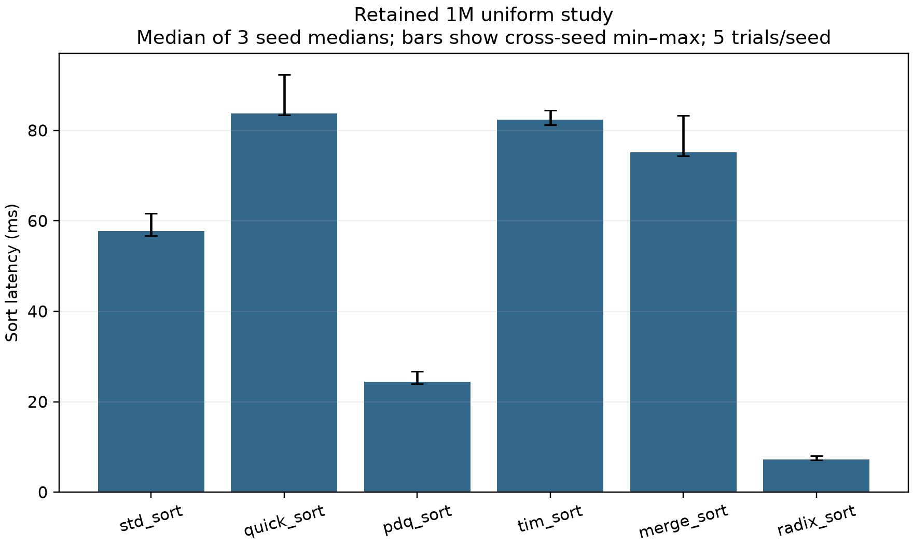
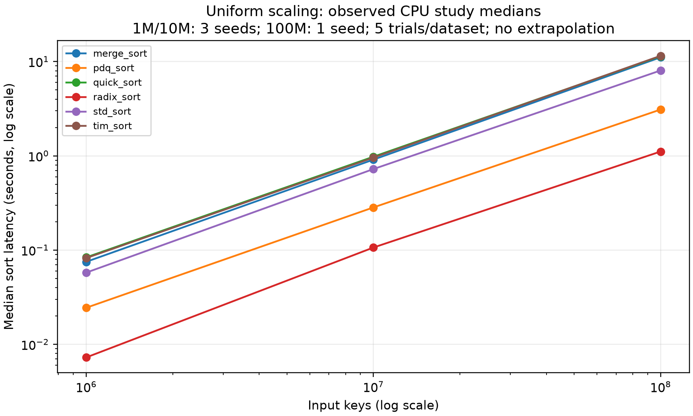
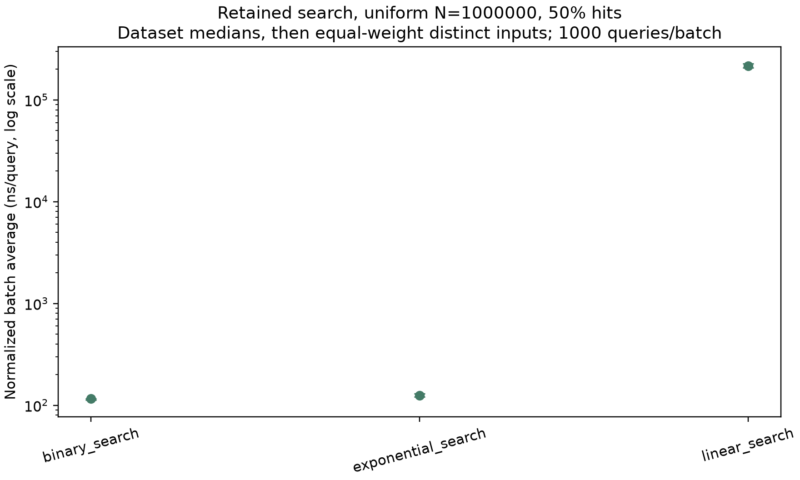
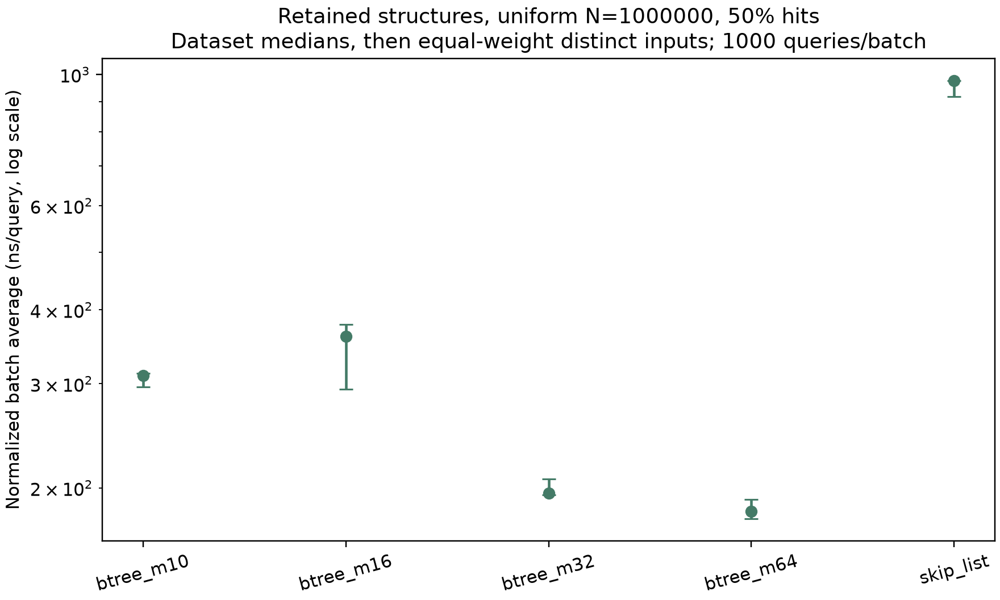

# Large-Scale Evaluation of Modern Search and Sorting Algorithms

Evidence-based report; full CPU/GPU comparison explicitly incomplete.

## 1. Abstract

This individual C++17/Python project evaluates six sequential sorting implementations, OpenMP Merge Sort, three array searches, Skip List and four B-tree orders, plus a simple learned rank index. The retained CPU experiments and new held-out learned/10M/100M studies provide descriptive evidence. The new scale extension completed 600 measured sorts and 120 warm-ups, all correct. The learned study completed 480 measured query batches and 240 measured builds. A historical Tesla T4 CUB correctness suite and prepared-buffer timing smoke exist; the frozen full CPU/GPU study is NOT complete. Its external trust/runtime prerequisites remain unmet. No universal performance ranking or significance claim is made.

## 2. Introduction and research questions

How do input order and duplicate frequency affect concrete sort implementations? How do query outcome and location affect array and ordered-index lookup? How does OpenMP scaling compare with sequential Merge Sort? When does a rank model require correction or fallback? Which timing boundaries make a CPU/GPU comparison defensible? The project addresses these questions with deterministic inputs, full oracle checking and retained raw data.

## 3. Related work and implementation identities

PDQSort is Orson Peters’ upstream implementation at commit b1ef26a55cdb60d236a5cb199c4234c704f46726 (Zlib). Timsort is cpp-TimSort at99b612d9826e8387a30008f2b21be206181ad890 (MIT). std_sort is this toolchain’s standard-library sort, not renamed PDQSort or Timsort. QuickSort has a depth budget and heapsort fallback. Merge Sort is stable and uses a temporary vector. Signed Radix Sort uses four stable byte passes and a signed-order bit mapping. OpenMP tasks retain the sequential baseline. CUB3.0.1 DeviceRadixSort::SortKeys is pinned separately. See docs/ALGORITHMS.md and vendor UPSTREAM.json files for licenses/hashes. The learned endpoint model and AlphaDev research review are documented in docs/LEARNED_INDEX_PROTOCOL_v1.md and docs/ALPHADEV_STUDY.md.

## 4. Methodology and environment

Signed int32 generator-v1 uses a fresh mt19937_64(seed); distributions and rejection sampling are frozen in EXPERIMENT_PROTOCOL.md. All corresponding sorting calls use identical original inputs. Sorting uses steady_clock nanoseconds, excludes generation, input restoration, oracle work and serialization, and checks complete output equality after timing. Primary timing contains no comparison instrumentation. One warm-up and five repetitions are used. New CPU runs use Linux Pop!_OS kernel6.18.7, GCC13.3.0, CMake3.28.3, -O3 -DNDEBUG, Intel i5-11400H (6 physical/12 logical cores), and approximately16.48GB RAM. Governors report powersave; background load, caches, temperature and frequency were not controlled. Agent-launched benchmarks and builds were serialized; external background work was uncontrolled. Historical studies retain their own metadata and must not be treated as the same session. Study protocols and exact commands reside in the audit.

## 5. Results: retained 1M sorting study

Historical evidence:15 dataset configurations;450 measured sorts and90 warm-ups; six sorters, five distributions and three seeds. These observations show workload-dependent differences between concrete implementations, not a universal ordering.

|Algorithm|Distribution|Median of 3 dataset medians (ms)|Cross-seed min–max (ms)|
|---|---|---:|---:|
|std_sort|uniform|57.699|56.768–61.642|
|std_sort|sorted|8.740|8.643–8.763|
|std_sort|reverse_sorted|5.978|5.844–6.377|
|std_sort|duplicate_heavy|20.182|19.039–21.876|
|std_sort|nearly_sorted|10.407|10.272–10.946|
|quick_sort|uniform|83.771|83.424–92.384|
|quick_sort|sorted|74.459|74.436–77.685|
|quick_sort|reverse_sorted|72.090|68.861–76.610|
|quick_sort|duplicate_heavy|14.574|14.253–15.165|
|quick_sort|nearly_sorted|31.783|31.615–33.267|
|pdq_sort|uniform|24.457|24.016–26.767|
|pdq_sort|sorted|0.764|0.718–0.771|
|pdq_sort|reverse_sorted|1.558|1.427–1.584|
|pdq_sort|duplicate_heavy|4.248|4.211–4.691|
|pdq_sort|nearly_sorted|8.627|8.402–8.806|
|tim_sort|uniform|82.326|81.263–84.396|
|tim_sort|sorted|0.396|0.395–0.416|
|tim_sort|reverse_sorted|2.057|1.769–2.237|
|tim_sort|duplicate_heavy|40.939|39.185–42.375|
|tim_sort|nearly_sorted|7.693|7.554–8.073|
|merge_sort|uniform|75.129|74.384–83.319|
|merge_sort|sorted|10.942|10.408–10.969|
|merge_sort|reverse_sorted|10.903|9.199–11.224|
|merge_sort|duplicate_heavy|36.602|33.276–43.235|
|merge_sort|nearly_sorted|15.330|13.569–16.649|
|radix_sort|uniform|7.268|7.132–8.025|
|radix_sort|sorted|8.311|7.505–8.559|
|radix_sort|reverse_sorted|7.721|7.286–9.228|
|radix_sort|duplicate_heavy|13.286|12.710–13.410|
|radix_sort|nearly_sorted|8.388|7.423–8.775|

## 6. Results: CPU scale extension

10M:15 datasets across five distributions and three seeds;450 measured/90 warm-up sorts. 100M:five datasets across five distributions and seed1729;150 measured/30 warm-up sorts. All six sorters completed every configuration with full equality to the oracle. The policy estimate was160MB array payload at10M and1.6GB at100M, with separate512MiB/2048MiB caps and more than3GiB RAM safety headroom. These planning quantities are not measured RSS. The100M command-level lifetime RSS is retained in the /usr/bin/time log; it cannot isolate a single sorter.

|N|Algorithm|Uniform median of dataset medians (s)|Seed datasets|
|---:|---|---:|---:|
|1000000|merge_sort|0.075129|3|
|10000000|merge_sort|0.912025|3|
|100000000|merge_sort|11.109074|1|
|1000000|pdq_sort|0.024457|3|
|10000000|pdq_sort|0.283684|3|
|100000000|pdq_sort|3.100929|1|
|1000000|quick_sort|0.083771|3|
|10000000|quick_sort|0.979349|3|
|100000000|quick_sort|11.418277|1|
|1000000|radix_sort|0.007268|3|
|10000000|radix_sort|0.106515|3|
|100000000|radix_sort|1.111648|1|
|1000000|std_sort|0.057699|3|
|10000000|std_sort|0.724257|3|
|100000000|std_sort|8.052183|1|
|1000000|tim_sort|0.082326|3|
|10000000|tim_sort|0.957998|3|
|100000000|tim_sort|11.522670|1|

## 7. Results: search and ordered structures

The retained full CPU pipeline includes 7020 measured search batches and 13200 measured structure operations. Construction and lookup remain separate. Binary/exponential search return the first equal array index; structures implement unique-key set semantics. Mixed query batches use exact50% hit/miss ratios. The following is a representative retained uniform group. Batch time/query count is a normalized average, not a directly measured individual-query latency or maximum.

|Family|Algorithm|N|Normalized batch average (ns/query)|
|---|---|---:|---:|
|search|binary_search|1000000|115.577|
|search|exponential_search|1000000|124.227|
|search|linear_search|1000000|215649.975|
|structures|btree_m10|1000000|310.008|
|structures|btree_m16|1000000|360.870|
|structures|btree_m32|1000000|195.844|
|structures|btree_m64|1000000|182.350|
|structures|skip_list|1000000|976.069|

## 8. Results: learned rank index

The fixed endpoint affine model uses radius32, certified local lower-bound correction and a full binary-search fallback. The evaluation has48 workload configurations (1K/10K/100K/1M, four distributions, seeds42/2718/314159) and1000 queries/configuration,500 hits/500 misses. These contain24 distinct sorted input vectors: uniform, reverse and nearly sorted collapse to identical contents after sorting for a given size/seed. Workload labels are kept separate and are not pooled as independent datasets. Evaluation seeds are held out from performance tuning; some also appear in correctness tests, which did not tune the model. The indexed vector itself supplies model endpoints; this is not unseen-key neural generalization. 480 measured lookups,240 measured builds,144 warm-ups and48000 untimed diagnostic queries completed with no failures. Build includes the owned copy and validation. Query batches exclude build and diagnostics. summary.json retains fallback rates, correction distance, separate comparisons and logical memory. The model does not guarantee O(1) lookup; duplicate/skewed data can force O(logN) fallback.

|Distribution|Algorithm|Operation|Median of 3 dataset medians (ns)|
|---|---|---|---:|
|duplicate_heavy|binary_search|lookup_batch|34160.0|
|duplicate_heavy|learned_rank|build|578882.0|
|duplicate_heavy|learned_rank|lookup_batch|33748.0|
|nearly_sorted|binary_search|lookup_batch|154655.0|
|nearly_sorted|learned_rank|build|829069.0|
|nearly_sorted|learned_rank|lookup_batch|107055.0|
|reverse_sorted|binary_search|lookup_batch|106410.0|
|reverse_sorted|learned_rank|build|554255.0|
|reverse_sorted|learned_rank|lookup_batch|94804.0|
|uniform|binary_search|lookup_batch|125127.0|
|uniform|learned_rank|build|664637.0|
|uniform|learned_rank|lookup_batch|115328.0|

## 9. Results: OpenMP, GPU scope, comparisons and memory

The retained OpenMP scaling study completed1800 measured sorts and360 warm-ups across requested1/2/4/8-thread configurations. Its primary speedup baseline is sequential Merge Sort; parallel one-thread timing is separately identified. A fresh untimed diagnostic observed one-worker teams below32768 and two-worker teams at/above32768 locally; team size does not establish task participation or race freedom.

Historical T4 CUDA correctness and48 prepared timing-smoke configurations (sizes0/1/1025/65537) are retained. H2D/device/D2H use CUDA event scopes; prepared end-to-end uses the host clock and excludes allocation/setup. These diagnostic timings must not be used as a host-API CPU speedup denominator. The frozen48-dataset CPU/GPU study was not launched in this execution. The CLI exposed a meteredT4 rate of1.07 compute units/hour with0 balance; it was released before GPU execution. The independently reviewed evidence trust anchor is also absent; no approval was fabricated.

240 separate sort_metrics executions provide exact key-comparison counts for five adapters and process RSS. Radix counting is unsupported. Counts have consistent executed-key-predicate semantics but do not model moves, cache misses or total instructions. RSS includes input/runtime/allocator/instrumentation and is not isolated auxiliary space. See the separate metric figures and manifest.

## 10. Statistical interpretation and threats to validity

Repeated timings are first summarized within each dataset using median, mean, sample SD, min and max. Cross-seed summaries equally weight dataset medians; identical fingerprints are collapsed where the family analyzer specifies it. No outliers are discarded and no confidence interval or significance claim is inferred from three seeds. 100M uses one seed, so only within-dataset variability exists. CPU/GPU transfer and host-call scopes are incompatible with device-only speedup ratios. Shared runtime scheduling, SMT, allocator/cache history, frequency/thermal behavior and background load can confound observations. Key-only tests cannot empirically distinguish the order of equal payloads; stability follows the documented merge strategy and existing generic stability tests. Search individual-query maxima are not collected because the batch engine does not measure them; normalized batch maxima cannot substitute. Structure comparison/allocation metrics and a learned sorter selector remain unsupported/optional. ThreadSanitizer/OpenMP limitations in earlier audits mean ordinary passing tests are not a proof of race freedom.

## 11. Conclusion, reproducibility and references

The validated CPU implementation, held-out model evaluation and completed100M feasibility extension support workload-specific analysis. The frozen full CPU/GPU comparison remains blocked, so a final CPU/GPU performance conclusion would be unsupported. AlphaDev is reviewed from primary sources; no reinforcement-learning training or assembly discovery was reproduced.

Regenerate this report with `python3 report/generate.py --evidence results/raw/autonomous_completion_20261011T095554571762Z --learned results/processed/learned_rank_20261011T095554571762Z --metrics results/processed/count_memory_20261011T095554571762Z --output NEW_REPORT_DIRECTORY`. INPUTS_SHA256.json identifies every source summary; PLOTS.json records filters, units and transformations. FINAL_AUDIT.md and COMMANDS.md retain actual validation/build/experiment commands and failures. Raw CSV remains immutable; derived outputs use new directories.

Primary references: [PDQSort](https://github.com/orlp/pdqsort); [cpp-TimSort](https://github.com/timsort/cpp-TimSort); [NVIDIA CUB](https://github.com/NVIDIA/cccl/tree/v3.0.1/cub); [Kraska et al., SIGMOD2018](https://arxiv.org/abs/1712.01208v3); [Mankowitz et al., Nature2023](https://www.nature.com/articles/s41586-023-06004-9); [official AlphaDev archive](https://github.com/google-deepmind/alphadev).

