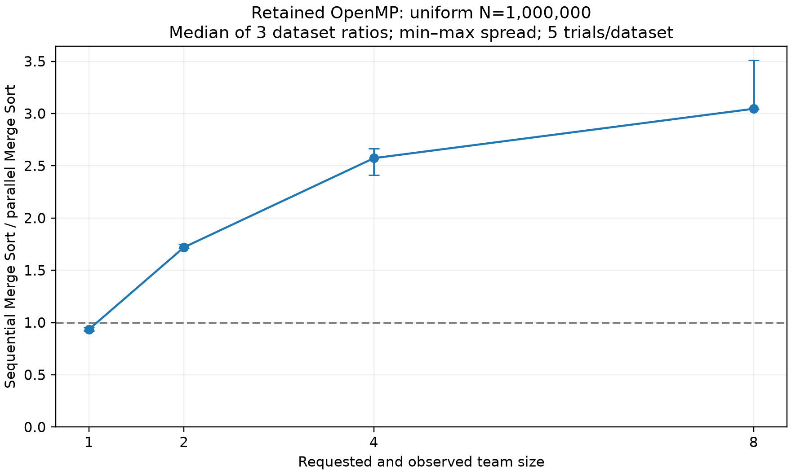

# Slide1: Modern Search and Sorting Benchmark

- CPU-only C++17/Python academic release
- Correctness first; reproducible raw data; scope-specific observations
- CPU studies complete for declared matrices; GPU execution/comparisons deferred

# Slide2: Research questions and implementations

- Six sequential sorters: std_sort, QuickSort, PDQSort, Timsort, Merge Sort, Signed Radix Sort
- Linear/Binary/Exponential Search; Skip List; B-tree orders10/16/32/64
- OpenMP Merge Sort and endpoint learned rank index

# Slide3: Experimental design

- Deterministic signed-int32 generator; identical inputs; oracle equality outside timing
- Release, steady_clock; one warm-up/five measured repetitions
- Separate key counts/process RSS; allocation scope documented per engine
- Dataset medians first; no outlier removal or unsupported significance claims

# Slide4: 1M sorting: workload-specific observations

- Uniform group shown; other distributions differ
- Three seed datasets, five trials each; spread is not a confidence interval

# Slide5: CPU scaling through100M

- 10M:450 measured +90 warm-ups;100M:150 measured +30 warm-ups
- All six sorters, five distributions;100M has one seed
- Log/log axes; distinct study sessions; no extrapolated performance

# Slide6: Search: query outcome and position matter

- Same1000-query mixed50% batch for each searcher
- Normalized batch average, not directly measured individual-query latency

# Slide7: Ordered structures

- Skip List and B-tree variants; ordered maps preserve first-inserted payloads
- Construction and lookup timed separately; representative uniform lookup shown

# Slide8: Learned rank index

- Endpoint affine prediction; radius32 correction; certified binary fallback
- 48 held-out configurations;480 measured lookup batches;240 measured builds
- 48000 separate diagnostics; counts, correction distance, fallback and logical storage retained
- No constant-time guarantee; duplicate-heavy data can be poorly predicted

# Slide9: OpenMP scaling

- 1800 sorts;360 warm-ups;1/2/4/8 teams
- Sequential Merge Sort baseline; cross-seed median/min–max
- Team size does not prove task participation or race freedom

# Slide10: Comparison counts and memory

- 240 separate instrumented executions; five comparison adapters; Radix count unsupported
- Comparison counts exclude moves, bookkeeping and instructions
- RSS is whole-process lifetime peak, not isolated auxiliary allocation
- All plots derive from retained observations; missing metrics remain explicit

# Slide11: Limitations and AlphaDev

- Background load, frequency, thermals and cache state not controlled
- Three seeds do not establish statistical significance;100M has one seed
- Batch averages cannot establish maximum individual-query latency
- AlphaDev primary-source review only: no training/discovery reproduction

# Slide12: Conclusion and reproducibility

- CPU-only studies/report are reproducible from retained raw evidence
- All historical assets preserved; GPU source/protocols/pilots deferred in place
- No CPU-versus-GPU comparison; deferred guards remain enforced
- RAW_VERIFICATION.json, INPUTS_SHA256.json, PLOTS.json and audits trace the results

